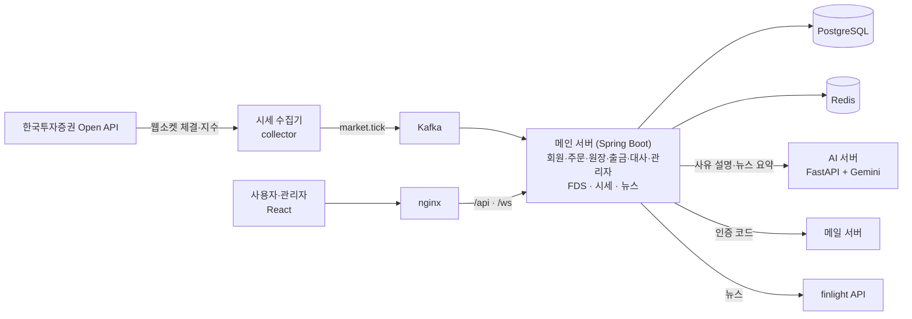

# StockShield

**실시간 모의 증권 거래 기반 FDS 관제 및 원장 정합성 검증 시스템**

실시간 시세로 매수, 매도, 모의 출금을 하는 모의투자 증권 사이트에서, 도용된 계정으로 돈이 빠져나가거나 장부가 틀어지는 일을 막는 데 집중한 프로젝트다.

- 비밀번호가 유출돼도 처음 보는 IP나 기기로는 로그인할 수 없고, 큰 금액은 출금 비밀번호 없이 나가지 않는다.
- 같은 계좌에 요청이 동시에 오거나 두 번 와도 잔고가 음수가 되거나 같은 돈이 두 번 나가지 않는다.
- 그래도 장부가 틀어지면 장 마감 뒤 원장 대사로 찾아 관리자에게 알린다.

## FDS 규칙

판단은 규칙으로만 한다. AI(Gemini)는 이미 내려진 판단을 관리자가 읽기 쉽게 설명만 한다.

| 규칙 | 조건 | 조치 |
|---|---|---|
| ① 새 접속 본인 인증 | 처음 보는 IP 또는 기기로 로그인 | 이메일 6자리 코드를 통과해야 토큰 발급. 코드는 5분 유효, 5회 틀리면 무효 |
| ② 대량 출금 추가 인증 | 1회 또는 24시간 누적 500만 원 이상 | 출금 비밀번호 요구. 5회 틀리면 계좌 임시 잠금, 관리자만 해제 |
| ③ 새 IP 직후 거래 | 새 IP 인증 뒤 24시간 안의 체결, 신뢰 목록에 없는 IP의 체결 | 주문은 그대로 두고 탐지 기록과 관제 경보만 |
| ④ 위험 의심 종목 | 1분 수익률 Z-Score 3 이상 또는 전일 대비 ±10% | '위험 의심 종목(급등/급락)'과 근거 표시. 주문은 막지 않음 |

탐지 기록은 `fds_detection` 테이블 하나에 남고, 관제 화면에는 WebSocket으로 실시간 경보가 뜬다. 관리자는 탐지를 확인하고 계좌를 잠그거나 풀 수 있다. 모든 조치는 사유와 함께 고칠 수 없는 이력으로 남는다.

## 원장 정합성

| 위험 | 방어 |
|---|---|
| 동시 주문과 출금이 같은 잔고를 두 번 사용 | 계좌 행 하나만 `SELECT … FOR NO KEY UPDATE`로 잠그고, 대기는 2초까지 |
| 버튼 두 번, 재시도로 같은 요청이 두 번 처리 | 계좌 단위 멱등키를 계좌 락 안에서 확인하고, 주문은 락 밖에서도 한 번 더 확인. DB UNIQUE가 최후 방어 |
| 처리 중 오류로 돈과 기록이 어긋남 | 원장, 주문(출금), 내역을 한 트랜잭션으로 커밋. 업무 거절도 사유와 함께 저장하고 시스템 오류만 롤백 |
| 기록 변조 | 거래 테이블과 감사 테이블은 앱 DB 계정에 UPDATE, DELETE 권한 없음 |
| 그래도 장부가 틀어짐 | 평일 16:00 원장 대사. 모든 계좌의 예수금과 종목별 수량을 체결, 출금 내역으로 다시 계산해 비교하고, 불일치는 관제 경보와 GitHub 이슈로 알림 |

이 방어들은 실제 PostgreSQL에 여러 스레드로 동시 요청을 보내는 테스트로 확인했다. 보호 장치를 하나씩 빼면 그 테스트가 실패하는 것도 확인했다. 예를 들어 계좌 락을 빼면 300만 원 2건 동시 출금이 둘 다 나가고, 100건 동시 요청 뒤 예수금이 내역 합계와 78만 원 어긋난다. 자세한 설계와 테스트는 [backend/README.md](backend/README.md)에 있다.

## 구조



- Kafka는 실시간 시세 전달에만 쓴다. 로그인, 주문, 출금은 Kafka를 거치지 않고 메인 서버가 바로 처리한다.
- 주문 체결가는 Redis에 있는 최신 시세다. Kafka나 수집기가 멈춰 시세가 60초 넘게 끊긴 종목은 오래된 가격으로 체결하지 않도록 주문을 거절한다. 로그인과 출금은 그대로 동작한다.
- 그림의 nginx는 배포 구성이다. 로컬 개발에서는 화면의 Vite 개발 서버가 `/api`와 `/ws`를 메인 서버로 넘긴다.
- 배포는 AWS EC2 한 대에 Docker Compose로 컨테이너 7개(PostgreSQL, Redis, Kafka, 메인 서버, 시세 수집기, AI 서버, 화면을 담은 nginx)를 띄우고, 서비스 포트는 nginx 80번 하나만 연다.

## 기술 스택

| 구분 | 사용 |
|---|---|
| 메인 서버 | Java 17, Spring Boot 3.3.5, Spring Security(JWT), Spring Data JPA, Spring WebSocket(STOMP), Spring Kafka, Spring Mail, Flyway |
| 시세 수집기 | Spring Boot, 한국투자증권 웹소켓 |
| AI 서버 | Python 3.12, FastAPI, Google Gemini API |
| 화면 | React 18, Vite 5, 차트는 SVG로 직접 그림 |
| 데이터 | PostgreSQL 15.19, Redis 7.2.17, Apache Kafka 3.7.2(KRaft) |
| 테스트 | JUnit 5, Testcontainers, k6, pytest |
| 배포, CI | Docker Compose, nginx, AWS EC2, GitHub Actions |

## 폴더

| 폴더 | 내용 | 안내 |
|---|---|---|
| `backend/` | 메인 서버 | [backend/README.md](backend/README.md) |
| `collector/` | 시세 수집기 | [collector/README.md](collector/README.md) |
| `ai-server/` | AI 서버 | [ai-server/README.md](ai-server/README.md) |
| `frontend/` | 증권 사이트와 관제 화면 | [frontend/README.md](frontend/README.md) |
| `infra/` | 로컬 개발용 Docker Compose, 배포 구성 | [infra/README.md](infra/README.md) |
| `.github/workflows/` | CI, 공격 시나리오, 정기 대사 결과 확인 | 아래 'GitHub Actions' |

## 로컬 실행

JDK 17, Docker Desktop, Node.js 20, Python 3.12가 필요하다. 명령은 저장소 루트에서 시작한다.

1. `infra/.env.example`을 복사해 `infra/.env`를 만들고 값을 채운다. 키 설명은 [infra/README.md](infra/README.md)에 있다.
2. PostgreSQL, Redis, Kafka를 띄운다.

   ```powershell
   docker compose -f infra/docker-compose.yml up -d
   ```

3. 메인 서버, 시세 수집기, AI 서버, 화면을 각 폴더의 README대로 실행한다. 한국투자증권 키가 없으면 수집기는 가짜 시세(MOCK)를 보낸다.

## GitHub Actions

develop과 main에는 아래 네 검사를 모두 통과해야 merge된다.

| 검사 | 워크플로 | 내용 |
|---|---|---|
| backend | `ci.yml` | 메인 서버 테스트 304개. Testcontainers로 실제 PostgreSQL과 Redis를 띄우고, 원장 동시성, 멱등, 롤백, 대사 테스트를 포함 |
| ai-server | `ci.yml` | AI 서버 테스트. Gemini는 가짜 응답 |
| frontend | `ci.yml` | 화면 빌드 |
| fds-scenario | `fds-scenario.yml` | 공격 시나리오 10개를 실제 FDS로 실행하고 결과를 PR 코멘트로 남김 |

공격 시나리오는 새 기기 로그인, 인증 코드 5회 오류, 1회 대량 출금, 분할 대량 출금, 동시 분할 출금, 대량 출금 비밀번호 일치, 출금 비밀번호 5회 오류, 새 IP 직후 거래, 가짜 급등 시세, 같은 멱등키 동시 주문이다.

`reconcile.yml`은 평일 16:20에 그날, 08:50에 직전 평일의 정기 대사 결과를 내부 토큰으로 읽는다. 불일치나 실패가 있으면 이슈를 만든다.

## 팀

| 이름 | 담당 |
|---|---|
| 조성우 (팀장) | 회원가입, 로그인(JWT), 권한과 인증 보안, 주문과 원장 반영(계좌 락, 멱등키), 모의 출금, 원장 대사, 관리자 API, DB와 API 설계, 부하 테스트 |
| 윤제정 | 시세 수집(Kafka → Redis), FDS 판단과 탐지 기록, AI 서버(Gemini), 뉴스·일봉·호가 API, Docker, GitHub Actions, AWS 배포 |
| 한승희 | 화면 설계, 증권 사이트(시세, 차트, 호가, 주문, 내 계좌, 출금), 인증 화면, FDS 관제 화면과 실시간 알림 |

개발 기간: 2026-10-28 ~ 2026-11-20
